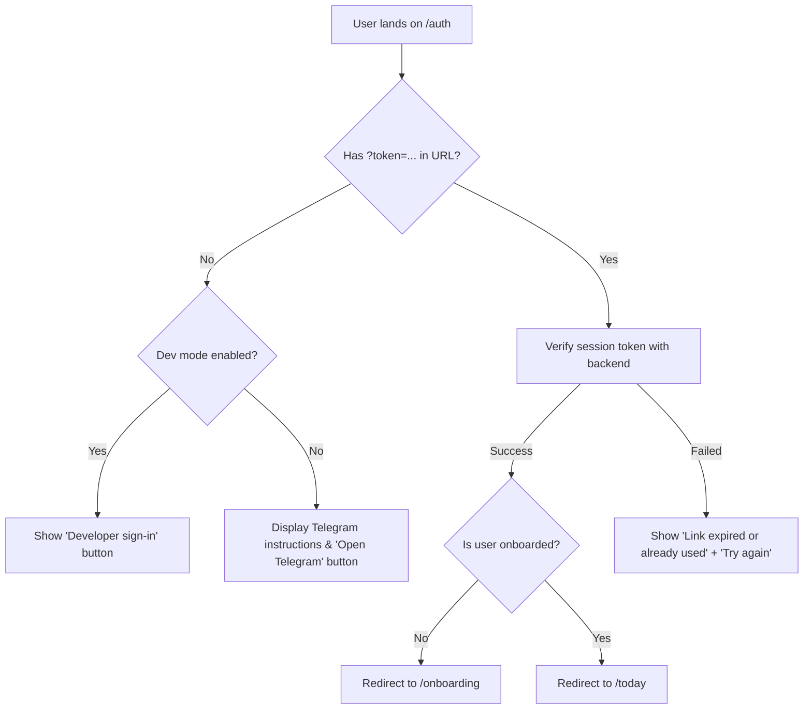
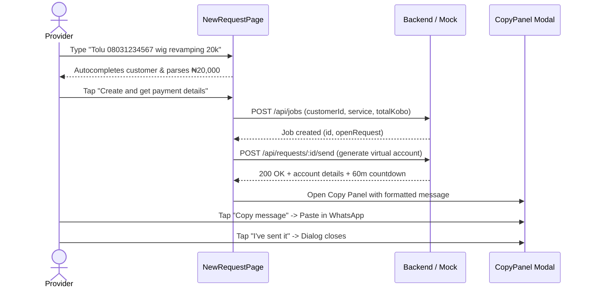
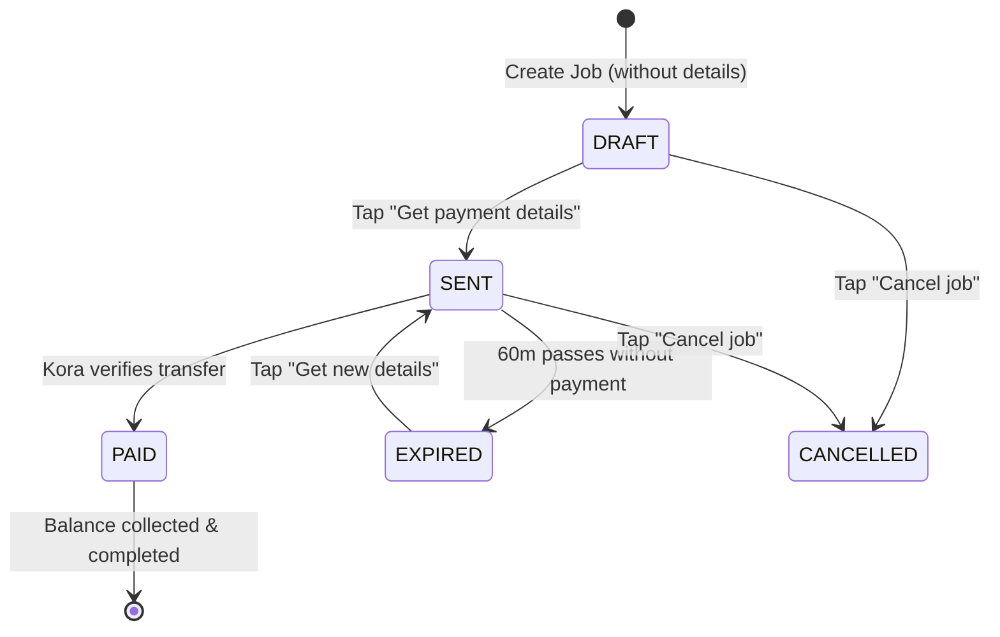

# Paidar (DonPay) — Comprehensive User Interaction Flows

This document provides a thorough, step-by-step description of every user interaction flow and interactable element across the entire Paidar application. It covers both the **Service Provider** (the core business user) and the **Customer** (the person paying via bank transfer).

---

## Architecture & Mental Model

Paidar operates on the principle of **Provider-Controlled Delivery**:
1. **The app never sends automated messages to customers.** The provider creates payment details, copies them (or individual fields), and pastes them into their existing chat channel (WhatsApp, Telegram, Instagram DM, SMS).
2. **Dynamic Virtual Accounts:** Every payment request allocates a one-time Wema Bank virtual account via Kora, valid for 60 minutes.
3. **Automated Bank Verification:** When the customer transfers money from any Nigerian banking app or USSD, Kora verifies the credit and triggers an instant in-app ping and Telegram alert.
4. **Transparent Triage:** Today acts as a live inbox showing what needs attention right now (payments to verify, reminders due, balances to collect, expired links to regenerate).

---

## 1. Authentication & First Contact (`/auth`)

### Scenarios
- **Brand New Provider:** Lands on the web app for the first time without an account.
- **Returning Provider:** Opening the app on a new device or after session expiry.
- **Developer / Demo User:** Testing without Telegram infrastructure.



### Interactable Elements & Behavior
1. **"Sign in or get started" Header:**
   - Explains that Paidar accounts are connected through Telegram for instant payment alerts.
2. **"Open Telegram" Button:**
   - *Action:* Launches `https://t.me/<bot_username>?start=login` in a new browser tab or Telegram client.
   - *Guidance Text:* Instructs new users to send `/start` and returning users to send `/login`.
3. **"Try again" Button (on expired/invalid link):**
   - Appears when a Telegram sign-in token has expired (older than 10 minutes) or has already been consumed.
   - Clears the failed token from URL query params and resets the page.
4. **"Quick sign-in for local development" (Dev Mode Only):**
   - Renders only when `VITE_DEV_LOGIN=true` or running in mock mode.
   - 1-tap bypass that logs into the demo provider account (`Tolu's Glam Studio`).

---

## 2. Onboarding Flow (`/onboarding`)

First-time users are guided through a focused 3-step setup before reaching the main dashboard.

### Step 1: Business Profile
- **"Business name" Input:**
  - Auto-focused text input (up to 80 characters).
  - As the provider types, a **Live Customer Preview** updates in real-time below the field:
    > *Customers will see: Pay ₦25,000 to **{Business Name}***
  - *Validation:* Required field. Empty submission displays inline error: *"Enter your business name"*.
- **"Continue" Button:** Advances to Step 2.

### Step 2: How Payments Work
- Educational transition explaining the core operating model:
  - **Provider-controlled delivery:** Paidar never messages customers directly; you copy and paste details into chat.
  - **Dynamic accounts:** One-time Wema Bank virtual accounts generated via Kora, active for 60 minutes.
  - **Automated confirmation:** Kora verifies credits directly and pings you the second funds clear.
- **"Next" Button:** Advances to Step 3.

### Step 3: Operating Rules & Notifications
- **"Ready to start" Rule (Segmented Radio Cards):**
  - Option A: *After deposit* (Work begins once deposit is paid; balance collected later).
  - Option B: *After full payment* (Work begins only when 100% is paid upfront).
- **"Evening summary" Switch:**
  - Toggle switch enabling a daily recap of who paid, who owes, and pending follow-ups.
- **"Send it at" Time Input (visible only when Evening summary is toggled ON):**
  - Native 24-hour time selector (defaults to `19:30` Lagos local time).
- **"Complete setup" Button:**
  - Saves preferences, records completion in `localStorage`, and transitions directly to `/today`.

---

## 3. Global Shell & Navigation

The persistent shell surrounds all authenticated pages:

```
┌────────────────────────────────────────────────────────┐
│  [Logo] paidar                                    [T]  │  <- Mobile Top Bar
├────────────────────────────────────────────────────────┤
│  [Offline / Update / Demo Banners if active]           │
├────────────────────────────────────────────────────────┤
│                                                        │
│                     PAGE CONTENT                       │
│                                                        │
├────────────────────────────────────────────────────────┤
│  [Today]      [Jobs]      [People]      [Search]       │  <- Mobile Tab Bar
└────────────────────────────────────────────────────────┘
```

### Interactable Elements
1. **Brand Logo (`LogoMark`):**
   - Click/tap navigates to `/today`.
   - Uses unique gradient IDs to prevent SVG rendering artifacts on dual-rail desktop displays.
2. **Provider Avatar Button (Top Right):**
   - Displays the provider's business initial (e.g. `T`).
   - Click/tap navigates to `/settings`.
3. **Tab Bar Navigation (Bottom on Mobile, Left Rail on Desktop):**
   - **Today (`/today`):** Daily action queue, active timers, incoming pings.
   - **Jobs (`/jobs`):** Complete job list, filtering, payment timelines.
   - **People (`/people`):** Customer directory, balance summaries, CSV import.
   - **Search (`/search`):** Universal search, saved views, CSV export.
4. **Desktop Rail "New request" Button (`+ New request`):**
   - Persistent shortcut to `/new` on wide desktop screens.
5. **Floating Action Button (`+`):**
   - Floats on bottom-right of mobile screens when viewing lists; taps navigate to `/new`.
6. **Banners Layer:**
   - **Offline Banner:** Appears when `navigator.onLine` is false: *"New actions won't work until you reconnect."*
   - **Update Banner:** Appears when a new PWA service worker is ready with a **"Reload"** button.
   - **Risk Warning Banner:** Appears in production builds if demo switches (`VITE_MOCK` or dev simulation) were left enabled.

---

## 4. Creating a Request (`/new`)

Providers create payment details using either **Quick Entry NLP** or the **Structured Form**.



### Scenario A: Fast Quick Entry via Chat Text
1. Provider pastes text from customer chat into the **Quick entry** textarea:
   `"Fatima 08123456789 bridal robe 45k, 20k deposit, balance friday"`
2. The client parser extracts:
   - Name: `Fatima`
   - Phone: `08123456789`
   - Service: `bridal robe`
   - Total: `₦45,000`
   - Plan: `Deposit + balance`
   - Deposit: `₦20,000`
   - Balance due: Upcoming Friday's date
3. The structured form below auto-fills matching fields. Fields edited manually are locked against overwrite.
4. *Touch Safety:* Auto-focus is disabled on touch screens (`pointer: coarse`) so the mobile keyboard does not open immediately and obscure the screen.

### Scenario B: Customer Autocomplete
1. In the **Customer name** field, typing 2 or more letters (e.g. `"Tol"`) triggers a live query against known customers.
2. Matching chips appear immediately beneath the field:
   `[ Tolu Ade · 0803 123 4567 ]`
3. Tapping a suggestion auto-fills both **Customer name** and **Phone**, eliminating repeat typing errors.

### Scenario C: Form Fields & Options
- **Customer name:** Plain text (up to 80 chars).
- **Phone:** Validates against Nigerian formats (`080...`, `+234...`).
- **Service:** Plain text description (up to 120 chars, e.g. `"Aso-ebi tailoring"`).
- **How will they pay? (Segmented Control):**
  - `In full`: Single payment for the total amount.
  - `Deposit + balance`: Splits payment into initial deposit and remaining balance.
- **Total price (₦):** Formatted input (supports raw numbers `50000`, comma formatted `50,000`, or shortcuts `50k`).
- **Deposit (₦) (if Deposit + balance):** Must be strictly less than total. Live hint shows computed remaining balance.
- **Balance due (optional):** Date picker for when the provider expects the final balance.

### Actions
1. **"Create and get payment details" (Primary Submit):**
   - Shows countdown warning: *"Getting payment details creates a dynamic virtual account and starts its 60-minute countdown."*
   - Allocates the Wema Bank account via Kora.
   - Redirects to `/jobs/:id` and automatically opens the **Copy Panel**.
2. **"Save without creating details" (Secondary Line Button):**
   - Saves customer and job as a `DRAFT` without starting the 60-minute countdown clock.
   - Useful when preparing jobs ahead of time before the customer is active in chat.

---

## 5. The Copy Panel (Share Sheet)

The modal dialog where providers retrieve and copy payment details.

### Visual Layout
- **Countdown Ring:** Live 60-minute circular progress ring displaying time remaining (e.g. `58:20 remaining`).
- **Header Line:** *"Pay exactly ₦25,000 · Started at 14:15. Valid for 60 minutes."*

### Interactable Copy Actions
1. **"Copy message" (Primary Full-Width Button):**
   - Copies the full pre-composed message into the system clipboard:
     > *Hi Tolu, here are your payment details for bridal makeup.*
     > *Amount: ₦25,000*
     > *Bank: Wema Bank*
     > *Account number: 0123456789*
     > *Account name: Kora / Tolu's Glam Studio*
     > *Pay before 15:15 (expires in 60 minutes).*
     > *Or view and pay here: https://paidar.ng/p/abc123xyz*
   - Shows feedback toast: *"Message copied"*.
   - Automatically marks the request as **Details copied** with the current timestamp.
2. **Itemized Copy Rows:**
   For customers who say *"Just send account number"*:
   - **Account Number Row:** Shows `0123456789` + **"Copy"** button (copies plain digits).
   - **Bank Row:** Shows `Wema Bank` + **"Copy"** button.
   - **Account Name Row:** Shows `Kora / Business Name` + **"Copy"** button.
   - **Amount Row:** Shows `25000` + **"Copy digits"** button (plain digits with no currency symbols or commas for easy pasting into Nigerian banking apps).
   - **Payment Link Row:** Shows `https://.../p/:token` + **"Copy link"** button.
3. **Selectable Text Area (Fallback):**
   - Read-only text box containing the message.
   - Clicking or tapping anywhere inside automatically selects all text (`e.target.select()`) for manual clipboard copy on older devices.
4. **App Launchers:**
   - **"Open WhatsApp":** Opens `https://wa.me/?text=...` with the prefilled message.
   - **"Telegram":** Opens Telegram share dialogue.
5. **Workflow Closing Actions:**
   - **"I’ve sent it" Button:** Marks request as copied and closes the dialog.
   - **"Done" Button:** Dismisses the modal.

---

## 6. The Today Screen (`/today`)

The provider's operational command center, divided into 6 distinct triage queues:

```
┌────────────────────────────────────────────────────────┐
│  Today                                                 │
│  Live · updated 12s ago                                │
├────────────────────────────────────────────────────────┤
│  🔴 NEEDS REVIEW (1)                                  │
│     [₦25,000 paid after account expired] -> [Resolve]  │
├────────────────────────────────────────────────────────┤
│  🟢 JUST PAID (2)                                      │
│     [Tolu Ade · ₦25,000] -> [Ready to start]           │
├────────────────────────────────────────────────────────┤
│  🔔 REMINDERS DUE (1)                                  │
│     [Amina Bello · Bal due] -> [Get payment details]   │
├────────────────────────────────────────────────────────┤
│  🟡 WAITING FOR PAYMENT (3)                            │
│     [Chidi Okafor · ₦15,000 · 42m left · Copied]       │
│     [Kelechi Eze · ₦30,000 · Customer says paid]       │
├────────────────────────────────────────────────────────┤
│  ⏳ BALANCES DUE (2)                                   │
│     [Zainab Umar · ₦10,000 balance]                    │
├────────────────────────────────────────────────────────┤
│  ⚠️ EXPIRED — SEND AGAIN (1)                           │
│     [Bola Tinubu · ₦5,000] -> [Get new details]        │
└────────────────────────────────────────────────────────┘
```

### Live Behavior
- Automatically polls the backend every 15 seconds while waiting for payments; every 30 seconds otherwise.
- Smooth skeleton loaders eliminate layout jumping during background refetches.

### Section Actions
1. **Needs review:**
   - Highlights transactions requiring human decisions (e.g. customer paid after the 60-minute window, overpaid, or paid an unmatched amount).
   - Tapping an item opens `/review` with suggested resolutions.
2. **Just paid:**
   - Highlights payments received in the current shift.
   - Shows **"Ready to start"** badge if the job meets the provider's threshold.
   - Includes **"Share receipt"** button opening the receipt copy panel.
3. **Reminders due:**
   - Lists jobs with follow-up dates scheduled for today.
   - Includes 1-tap **"Get payment details"** button.
4. **Waiting for payment (Active Tickets):**
   - Renders ticket cards with real-time countdown radar rings.
   - Displays copy status: *"copied 4m ago"* or *"not copied yet"*.
   - **"Customer says paid" Badge:** Appears in amber if the customer tapped the transfer confirmation button on their payment link.
   - **"Check now" Button:** Immediately forces a bank query and displays feedback toast (*"Checking with bank for payments…"*) without waiting for the next poll cycle.
   - **"Show payment details" Button:** Re-opens the copy panel to resend account numbers.
5. **Balances due:**
   - Lists jobs where initial deposit was paid and remaining balance is due.
   - 1-tap **"Get balance details"** button generates a fresh virtual account for the exact outstanding balance.
6. **Expired — send again:**
   - Lists virtual accounts that hit their 60-minute limit without being paid.
   - **"Get new details" Button:** Generates a fresh virtual account with a renewed 60-minute timer in one tap.

---

## 7. The Paid Ping Moment

When Kora confirms a customer transfer while the app is open:

1. **Visual Toast:**
   - A floating card slides in from the top with animated radar pulse rings:
     > **Tolu paid ₦25,000**
     > *Bridal makeup · Ready to start*
2. **Haptic Feedback:**
   - Fires a gentle double vibration (`navigator.vibrate(80)`).
3. **Interactions:**
   - Tapping the notification card dismisses the banner and navigates directly to `/jobs/:id`.
   - Tapping the `X` icon dismisses the ping.
   - Auto-dismisses after 9 seconds if untouched.
   - Stacks up to 3 simultaneous payment pings.

---

## 8. Job Page & Actions (`/jobs/:id`)

The definitive ledger for an individual customer order.



### Interactable Elements
1. **Header Navigation:**
   - Back link (`< Jobs`) returns to full job list.
   - Customer name link navigates to `/people/:customerId`.
2. **Top Actions:**
   - **"Edit" Button:** Opens modal to edit service description, notes, balance due date, or ready-to-start rule.
   - **"Record a payment" Button:** Opens modal to log manual offline payments (cash, personal bank transfer, POS):
     - Amount input (₦).
     - Received date picker.
     - Optional notes.
     - Saves payment marked as *Unverified* (dashed trust border) to distinguish from automated Kora transfers.
3. **Payment Progress Bar:**
   - Visual fill showing percentage paid vs total price.
   - Plain English summary: *"₦25,000 paid of ₦50,000 · ₦25,000 still to pay · due Friday"*.
4. **Active Request Card:**
   - Ticket view showing the current open payment request (Draft, Sent, or Expired).
   - **"Cancel" Button:** Opens confirmation dialog with honest safety warning:
     > *"If Tolu already has these details, a payment may still arrive. It will show in Needs review."*
5. **Timeline:**
   - Merged reverse-chronological activity log:
     - *Details created (60-minute account allocated)*
     - *Details copied by provider*
     - *Customer claimed payment*
     - *Payment verified via Kora (₦25,000)*
     - *Manual payment recorded*
   - Each verified payment includes a **"Share receipt"** button that opens a pre-formatted receipt message to copy to the customer.
6. **Cancel Job Section:**
   - Red button at page bottom to cancel an aborted job entirely.

---

## 9. Customer Directory & Repeat Work (`/people` & `/people/:id`)

### Customer Directory (`/people`)
- **Search Bar:** Real-time filter by customer name or phone number.
- **Customer List Rows:**
  - Displays customer name, phone, number of jobs, and outstanding balance in red if money is owed.
- **"Add customer" Button:**
  - Fast modal to save Name and Phone without immediately creating a job.
- **"Import CSV" Button:**
  - Bulk import tool supporting CSV files with `name` and `phone` columns.
  - Displays detailed import results modal (*"24 created, 2 skipped"* with line-by-line error notes).

### Customer Profile (`/people/:id`)
- **Summary Banner:** Total outstanding debt across all active jobs.
- **"New request" Button:** Opens `/new?customerId=...` with customer details locked in.
- **"Repeat last job" Button (High-Value Flow):**
  - Appears whenever the customer has at least one previous job.
  - 1-tap shortcut that opens `/new` with `customerId`, `service`, `plan`, `total`, and `deposit` already filled with values from their previous order.
- **"Edit" Button:** Update customer name or phone number.
- **Customer Jobs List:** History of every job ever created for this customer.
- **Timeline:** Consolidated payment history for this customer across all jobs.

---

## 10. The Customer Payment Page (`/p/:token`)

The standalone, responsive web page opened by the customer when tapping the link in chat. Works on all mobile devices with **zero login or app installation required**.

```
┌────────────────────────────────────────────────────────┐
│  Tolu's Glam Studio                                    │
│  Payment request for Fatima                            │
├────────────────────────────────────────────────────────┤
│  [60m Countdown Ring: 54:12 remaining]                 │
│                                                        │
│  Amount to Pay:                                        │
│  ₦25,000.00                                            │
│  [ Copy Plain Digits (25000.00) ]                      │
├────────────────────────────────────────────────────────┤
│  Bank: Wema Bank                          [ Copy ]     │
│  Account Number: 0123456789               [ Copy ]     │
│  Account Name: Kora / Tolu's Glam Studio               │
├────────────────────────────────────────────────────────┤
│  Transfer from any Nigerian bank app or USSD           │
├────────────────────────────────────────────────────────┤
│  [ I’ve already made this transfer ]                   │
└────────────────────────────────────────────────────────┘
```

### Scenario A: Active Payment (Status: `SENT`)
1. **Live Countdown:**
   - Displays circular countdown synced with server clock.
2. **Copy Actions:**
   - **"Copy Account Number"** button.
   - **"Copy Bank Name"** button.
   - **"Copy Plain Amount"** button (copies `25000.00` without currency symbols).
3. **"I’ve already made this transfer" Button:**
   - Customer taps after sending funds in their bank app.
   - Immediately notifies the provider dashboard (*"Customer says paid"* badge appears on provider's Today screen).
   - Replaces button with green confirmation:
     > *✓ Tolu's Glam Studio has been told. This page will update once the bank confirms your payment.*
4. **Live Polling:**
   - The page polls every 5 seconds. As soon as Kora verifies the transfer, the page seamlessly morphs into the **Receipt State** without requiring a page reload.

### Scenario B: Payment Verified (Status: `PAID` / Receipt View)
- Displays large green verification checkmark: **"Payment Confirmed"**.
- Displays formal digital receipt:
  - Amount Paid: `₦25,000.00`
  - Bank Reference: `KE-849201`
  - Service: `Bridal makeup`
  - Balance Remaining: `₦0.00` (or remaining balance due date).
- **"Print / Save Receipt" Button:** Triggers native browser print/PDF export dialog.

### Scenario C: Expired Link (Status: `EXPIRED`)
- Clean explanation:
  > *This payment account has expired.*
  > *To prevent lost transfers, this one-time virtual account closed. Please ask {Business Name} to generate a fresh payment link for you.*
- Deliberately does not include public contact forms or WhatsApp links, avoiding unwanted customer-to-provider inbound support loops.

---

## 11. Search, Review Queue & Data Export

### Search (`/search`)
- **Query Input:** Searches across customer names, phone numbers, and service descriptions.
- **Quick Filter Views (Chips):**
  - `Unpaid balances`: Filters to jobs with money still owed.
  - `This week`: Filters to activity in the last 7 days.
  - `Needs follow-up`: Filters to scheduled reminders and expired links.
- **Status Multi-Select Chips:**
  - `Paid`, `Waiting`, `Balance due`, `Expired`, `Needs review`.
- **Date Range Filters:** Native date inputs for `From` and `To`.
- **Inline Result Actions:** Each search result row contains a direct action button (e.g. *"Show payment details"*, *"Get balance details"*, *"Share receipt"*).
- **"Export CSV" Button:** Downloads filtered records formatted for Excel or Google Sheets.

### Needs Review Queue (`/review`)
- Reachable from Today when anomalies occur, or from Settings.
- Shows flagged payments (e.g. transfer arrived after 60-min expiry, or payer transferred unexpected amount).
- **Resolution Dialog:**
  - Option 1: *Accept payment toward this job*
  - Option 2: *Accept and create replacement request for balance*
  - Option 3: *Mark resolved (handled outside Paidar)*
  - Optional resolution note.
  - Clear reminder: *Paidar records transactions and allocates virtual accounts, but never moves money out of your personal bank accounts.*

---

## 12. Settings & Account (`/settings`)

### Settings Sections & Controls
1. **Business Profile:**
   - **Business name input:** Updates the public business name shown on payment links and receipts.
   - **Ready to start selector:** Changes default job readiness policy (*After deposit* vs *After full payment*).
2. **Alerts:**
   - **Telegram:** Shows connection status (`Connected` with green checkmark). If disconnected, offers **"Connect"** button opening bot link. Text explicitly notes: *(alerts to you only; Paidar never messages customers)*.
   - **Evening summary:** Toggle switch + delivery time picker.
3. **How Payments Work:**
   - Static educational cards covering provider-controlled delivery, virtual accounts, and automated verification.
4. **Appearance:**
   - Segmented theme picker: `Match device` | `Light` | `Dark`.
5. **On Your Phone (PWA Installation):**
   - If installed: Displays *"Paidar is installed on this device."*
   - If installable: Displays **"Install Paidar"** button triggering native PWA prompt.
   - If on iOS Safari: Displays step-by-step instructions (*"Tap Share, then Add to Home Screen"*).
6. **Account & App Info:**
   - **"Sign out" Button:** Clears local session and returns to `/auth`.
   - **"Open Needs review" Link.**
   - Version, contract version, and API connection status.

---

## 13. System Fail-Safes & Offline Handling

1. **Offline Mode:**
   - All previously loaded screens remain viewable from local browser cache.
   - Top banner clearly states: *"New actions won't work until you reconnect."*
   - Network failure displays inline retry buttons rather than blank crashes.
2. **Error Boundary (Crash Recovery):**
   - If an unhandled React runtime error occurs, the screen displays a safe fallback card:
     > *Something went wrong.*
     > *Anything you've already saved is still there. Reload to continue.*
   - Includes **"Reload"** action button.
3. **Idempotency Keys:**
   - Every mutating request (`POST`, `PATCH`, `DELETE`) automatically attaches a unique `Idempotency-Key` header (`ik_<timestamp>_<random>`).
   - If a provider with spotty cellular connection double-taps a button, the backend prevents duplicate job creation or duplicate virtual account generation.
4. **404 Not Found Page:**
   - Displayed when navigating to non-existent URLs or deleted jobs.
   - Includes friendly **"Back to Today"** button.

---

## Summary Matrix of User Scenarios

| User Intent | Starting Point | Primary Interaction | Outcome |
|---|---|---|---|
| **Collect money for new service** | Any screen | Tap `+` or `/new` -> Quick entry -> Tap *Create and get payment details* | 60-min Wema virtual account allocated; Copy Panel opens |
| **Send details to WhatsApp customer** | Copy Panel | Tap *Copy message* -> Switch to WhatsApp -> Paste -> Tap *I've sent it* | Customer receives details; request marked *Copied 1m ago* |
| **Customer asks for account number only** | Copy Panel / Request Card | Tap itemized *Copy* button next to Account Number | Plain 10 digits copied to clipboard |
| **Check if customer transfer landed** | `/today` or `/jobs/:id` | Check for *Customer says paid* badge -> Tap *Check now* | Bank queried immediately; toast confirms verification status |
| **Repeat regular customer's usual order** | `/people/:id` | Tap *Repeat last job* | Form on `/new` opens 100% pre-filled; 1 tap to generate details |
| **Collect remaining 50% balance** | `/today` (Balances due) | Tap *Get balance details* | Fresh virtual account allocated for exact remaining kobo balance |
| **Customer paid after 60 min expired** | `/today` (Needs review) | Tap flagged item -> Choose resolution -> Tap *Resolve* | Payment attached to job or credited to balance |
| **Provide proof of payment** | `/jobs/:id` (Timeline) | Tap *Share receipt* next to verified payment | Copy panel opens with formal digital receipt ready to paste |
